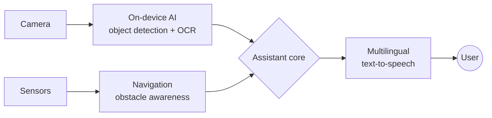
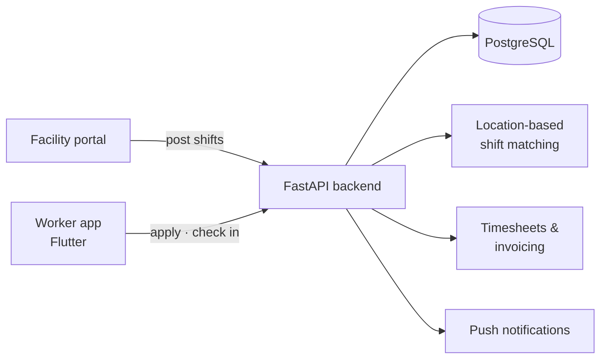
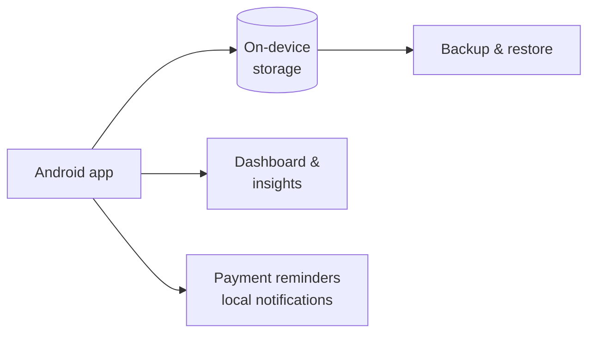

<picture>
  <source media="(prefers-color-scheme: dark)" srcset="./assets/hd2-dark.svg">
  <source media="(prefers-color-scheme: light)" srcset="./assets/hd2-light.svg">
  
</picture>

<p align="center">
  <a href="https://www.gazeguard.in"></a>
  <a href="https://www.linkedin.com/in/sooraj-suresh-gg/"></a>
  <a href="mailto:soorajsuresh0022@gmail.com"></a>
  <a href="mailto:soorajsuresh0022@gmail.com?subject=Project%20enquiry"></a>
  
</p>

## `01` &nbsp;// about

I'm an **entrepreneur and engineer** from Malappuram, Kerala: **Founder & MD of Gaze Guard**, **CTO of ShiftNua Technologies (Ireland)** and **CTO of Zeiroo**. I start with a real problem, not a product, and build the technology that solves it, from on-device AI hardware to full-stack web and mobile platforms. In **January 2027** I start a **B.S. in Computer & Information Security at the University of North Texas**.

I started building **Gaze Guard AI** in school: an offline assistive device that helps visually impaired people see, read and navigate. The project earned a **national selection in the ATL Marathon** and went on to become **Gaze Guard Pvt. Ltd.** in 2024.

Long-term goal: **a cybersecurity company that makes digital protection affordable** for individuals, small businesses and underserved communities.

```yaml
# sys.info
user:         sooraj_suresh
roles:        [ Founder & MD @ Gaze Guard Pvt. Ltd., CTO @ ShiftNua Technologies (IE), CTO @ Zeiroo ]
shipped:      [ OakVyapar — Google Play, shiftnua.com ]
education:    B.S. Computer & Information Security — University of North Texas (2027 → 2031)
prev:         Higher Secondary, SVHSS Palemad — 93.67%
location:     Malappuram, Kerala, IN  →  Denton, Texas, US
languages:    [ English, Malayalam ]
focus:        [ AI for accessibility, SaaS architecture, Application & Network Security ]
status:       open_to_work = true
```

## `02` &nbsp;// open to work

> **Available for part-time, freelance, contract and internship work, on any web or app project.** I take products from idea to launch: design, backend, mobile, deployment.

| Service | What I deliver | Tools |
|:--|:--|:--|
| 🌐 **Web apps & websites** | Business sites, landing pages, admin panels, dashboards, customer portals | Responsive web · FastAPI · PostgreSQL |
| 📱 **Mobile apps** | Android and cross-platform apps, offline-first apps, Play Store release | Flutter · Dart · Riverpod |
| ⚙️ **Backend & APIs** | REST APIs, JWT auth, role-based access, multi-tenant data models, migrations | Python · FastAPI · SQLAlchemy · Alembic |
| 📊 **SaaS & business tools** | CRMs, ERPs, inventory, billing and finance apps, workflow automation | Full stack |
| 🔗 **Integrations** | WhatsApp Cloud API, email, notifications, call tracking, third-party APIs | REST · Webhooks |
| 🔐 **Security-minded builds** | Secure auth, input validation, least-privilege access, data protection | OWASP practices |

<p align="center">
  <a href="mailto:soorajsuresh0022@gmail.com?subject=Project%20enquiry"></a>
</p>

## `03` &nbsp;// projects

### 👁️ Gaze Guard AI &nbsp;  
An **offline AI assistant for visually impaired people** that runs fully on-device, with no internet needed. It detects objects, reads printed text aloud, speaks multiple languages and helps with navigation.

<details>
<summary><b>▸ architecture & details</b></summary>



- **Object detection**: identifies everyday objects and obstacles in real time
- **Text recognition**: reads printed text (signs, labels, documents) aloud
- **Multilingual voice**: guidance in the user's own language
- **Offline-first**: built to work without internet, for affordability and privacy
- **My role**: founder, concept, AI and hardware integration, prototyping
- **Recognition**: ATL Marathon 2022–23 national selection · District Science Fair 1st place · Kerala State Science Fair participant
</details>

### 🔒 Zeiroo &nbsp;  
A **problem-first technology brand**: we choose an industry, identify the real problems people face, and solve them with technology. I lead technology as **Chief Technology Officer (CTO)**. **First products launching soon.**

### 🏥 [ShiftNua Technologies](https://shiftnua.com) &nbsp;   
I'm the **CTO of ShiftNua Technologies**, a healthcare staffing technology company in Ireland. Our platform is a **healthcare staffing platform for Ireland** that connects hospitals and care facilities with verified nurses and healthcare assistants (HCAs) who can cover shifts.

<details>
<summary><b>▸ architecture & details</b></summary>



- **Facilities**: post shift requirements, review applicants, confirm cover
- **Workers**: build a profile, manage credentials and documents, discover shifts nearby
- **Shift workflow**: attendance confirmation, timesheets, invoice and payment tracking
- **Web**: [shiftnua.com](https://shiftnua.com) is live; the app is in development
- **My role**: CTO, leading platform architecture, the website, FastAPI backend, PostgreSQL and Flutter apps
</details>

### 💼 [OakVyapar](https://play.google.com/store/apps/details?id=com.oakvyapar.app) &nbsp;  
An **offline-first business management app** built for PicoGrain. Small businesses use it to run inventory, billing and finances from a phone, without needing internet.

<details>
<summary><b>▸ architecture & details</b></summary>



- **Inventory**: products, categories, stock tracking
- **Finance**: income and expenses, pending payments, business summaries
- **Contacts**: customer and supplier records, employee details
- **Data**: stored locally on the device, with manual backup and restore and no third-party data sharing
- **Shipped**: published on Google Play
</details>

### 🔌 Embedded Systems Lab &nbsp; 
Microcontroller builds with sensors, displays and peripherals over **SPI and I²C**. This is the hardware foundation behind Gaze Guard. `Arduino` `C/C++`

## `04` &nbsp;// tech stack

<p align="center">
  <picture>
    <source media="(prefers-color-scheme: dark)" srcset="https://skillicons.dev/icons?i=python,fastapi,postgres,dart,flutter,androidstudio,git,github,linux,bash,arduino,vscode&theme=dark&perline=15">
    <source media="(prefers-color-scheme: light)" srcset="https://skillicons.dev/icons?i=python,fastapi,postgres,dart,flutter,androidstudio,git,github,linux,bash,arduino,vscode&theme=light&perline=15">
    
  </picture>
</p>

| Layer | Technologies |
|:--|:--|
| **Languages** | Python · Dart · SQL · Bash · C/C++ (embedded) |
| **Backend** | FastAPI · REST APIs · JWT authentication · SQLAlchemy ORM · Alembic migrations |
| **Database** | PostgreSQL · multi-tenant schema design · on-device storage |
| **Mobile** | Flutter · Riverpod · Android · Google Play publishing |
| **Integrations** | WhatsApp Cloud API · email · push and local notifications |
| **AI & hardware** | Object detection · OCR · text-to-speech · Arduino · sensors · SPI/I²C |
| **Tooling** | Git · GitHub · Linux · VS Code · Android Studio |

## `05` &nbsp;// security roadmap

```text
[ LEARNING ]  Network security          — protocols, traffic analysis, firewalls
[ LEARNING ]  Application security      — OWASP Top 10, secure auth, API hardening
[ LEARNING ]  Penetration testing       — recon, exploitation, reporting (Kali Linux)
[ QUEUED   ]  Cloud security            — IAM, misconfiguration, secure deployments
[ QUEUED   ]  Digital forensics & SOC   — monitoring, incident response, investigation
[ QUEUED   ]  AI-assisted security      — ML for threat detection
```
<sub>Formal study begins at UNT in January 2027. I'll update progress here as I go.</sub>

## `06` &nbsp;// timeline

| When | Milestone |
|:--|:--|
| **2022–23** | 🏆 Gaze Guard AI: **national selection, ATL Marathon** (Atal Innovation Mission) |
| **School** | 🥇 **1st place, District Science Fair** · Kerala **State Science Fair** participant |
| **Aug 2024** | 🚀 Founded **Gaze Guard Pvt. Ltd.**, Founder & Managing Director |
| **2026** | 📲 Shipped **OakVyapar** on Google Play for PicoGrain |
| **Oct 2026** | 🏥 Became **CTO of ShiftNua Technologies**, Ireland (website live) · 🔒 Joined **Zeiroo** as CTO |
| **Jan 2027** | 🎓 B.S. Computer & Information Security at **University of North Texas** |

## `07` &nbsp;// contact

```bash
$ contact --sooraj
  email     →  soorajsuresh0022@gmail.com
  web       →  https://www.gazeguard.in
  linkedin  →  https://www.linkedin.com/in/sooraj-suresh-gg/
  status    →  open to part-time, freelance, contract & internship work (web + app)
```

<picture>
  <source media="(prefers-color-scheme: dark)" srcset="./assets/footer-dark.svg">
  <source media="(prefers-color-scheme: light)" srcset="./assets/footer-light.svg">
  
</picture>
